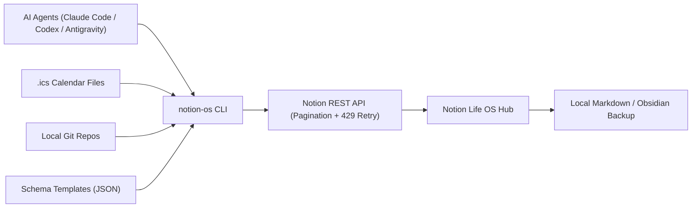

# notion-agent-os

**An agent-first Notion Life OS CLI, schema-as-code bootstrapper, bidirectional Markdown engine, and automation kit — with zero runtime dependencies.**

Built for developers, students, and researchers who want **Claude Code**, **Codex CLI**, **Antigravity**, and terminal scripts to share a single structured Notion workspace without bloated SDKs or brittle glue code.

---

## Why `notion-agent-os`?

Most Notion CLIs are thin CRUD wrappers. `notion-agent-os` treats Notion as an **operable knowledge graph for AI coding agents**:

- **Zero Runtime Dependencies:** Pure Python 3.10+ standard library (`urllib`, `json`, `argparse`). Installs in under a second anywhere.
- **Schema-as-Code (`notion-os init`):** Bootstrap an entire Life OS (Hub, Calendar DB, categories, and standardized `Info` / `Notes` two-layer entity pages) from a single JSON template in 30 seconds.
- **Token-Efficient `--compact` Mode:** Designed for LLM context windows — strips noise while preserving structure and page IDs.
- **Bidirectional Markdown Engine:** Full support for headings, inline formatting (`**bold**`, `*italic*`, `` `code` ``, `~~strike~~`, `[links](url)`), fenced code blocks, tables, to-dos, quotes, pagination, and recursive nested blocks.
- **Real-World Ingest Modules:**
  - `ingest ics` — RFC 5545 `.ics` parser (handles folded lines & timezones) to push flights, exams, or meetings directly into your Notion Calendar DB.
  - `ingest git` — Summarizes recent git commits into a clean Markdown digest appended to your project's Notes page.
- **Daily Briefing (`notion-os brief`):** Combines upcoming Calendar DB events and open `- [ ]` tasks across pages into a single terminal summary.
- **Obsidian-Compatible Export (`notion-os export`):** Recursively exports Notion page trees into local Markdown files with YAML frontmatter.
- **Multi-Agent Kit (`agent-kit/`):** Drop-in `AGENTS.md` and `SKILL.md` templates for Claude Code, Codex CLI, and Antigravity.

---

## Architecture



---

## Quickstart

### 1. Install

```bash
git clone https://github.com/zynordev/notion-agent-os.git
cd notion-agent-os
pip install -e .
```

### 2. Authenticate

Create a Notion Internal Integration at [notion.so/my-integrations](https://www.notion.so/my-integrations), connect it to a root page (`...` -> `Connections`), and save your token:

```bash
notion-os auth
# or use an environment variable:
export NOTION_TOKEN="ntn_your_secret_token"
```

Verify the connection:

```bash
notion-os whoami
```

### 3. Bootstrap a Life OS Workspace (Schema-as-Code)

Preview the creation plan first with `--dry-run`:

```bash
notion-os init --template templates/student-life-os.json --dry-run
```

Create it in Notion (saves created IDs to `~/.config/notion-agent-os/workspace.json`):

```bash
notion-os init --template templates/student-life-os.json --parent-id <YOUR_ROOT_PAGE_ID>
```

Two ready-to-use templates are included:
- `templates/student-life-os.json` — Academics, Research & Engineering Projects, Clubs, Freelance CRM, Practice, Network, and Calendar DB.
- `templates/developer-os.json` — Active Repos, Architecture/RFCs, Clients, Learning, and Schedule DB.

---

## CLI Reference

| Command | Description |
| :--- | :--- |
| `notion-os auth` | Securely save your Notion token (`chmod 600`) |
| `notion-os whoami` | Verify integration bot and workspace |
| `notion-os search [query] [--compact]` | Search pages and databases |
| `notion-os read <page_id> [-r] [--compact]` | Read a page (and nested blocks) as Markdown |
| `notion-os append <page_id> "<markdown>"` | Append Markdown blocks / `- [ ]` tasks |
| `notion-os push <page_id> <file.md>` | Push a local Markdown file to a Notion page |
| `notion-os create-page --parent-id <id> --title "..."` | Create a child page or DB entry |
| `notion-os db-query <db_id> [--filter '...']` | Query database rows with pagination |
| `notion-os init --template <tpl.json> --parent-id <id>` | Bootstrap a Life OS from JSON schema |
| `notion-os brief [--days 7] [--compact]` | Daily briefing: upcoming events + open tasks |
| `notion-os export <page_id> --out ./exports` | Recursive Notion-to-Markdown export |
| `notion-os ingest ics <file.ics>` | Import `.ics` events into your Calendar DB |
| `notion-os ingest git --repo . --page-id <id>` | Append recent git commits to a Notes page |
| `notion-os raw <METHOD> <endpoint> [--data '...']` | Raw Notion REST API escape hatch |

---

## Multi-Agent Setup

Copy [`agent-kit/AGENTS.md`](agent-kit/AGENTS.md) into your shared agent rules file or install [`agent-kit/SKILL.md`](agent-kit/SKILL.md) as an agent skill. Use `--compact` in agent prompts to keep context usage minimal.

---

## Running Tests

```bash
python3 -m unittest discover -s tests -v
```

---

## Security & Privacy

- Tokens are **never** hardcoded. `notion-os` reads `NOTION_TOKEN`, `~/.config/notion-agent-os/token`, or `~/.config/notion/token`.
- Local workspace manifests (`.notion-os.json`), `.env`, and `.ics` files are `.gitignore`d by default.

## License

MIT — see [LICENSE](LICENSE).
